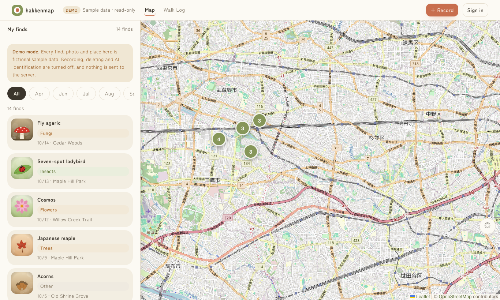
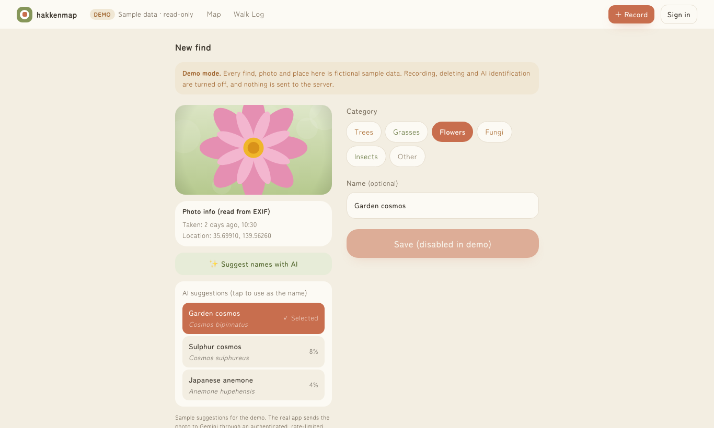
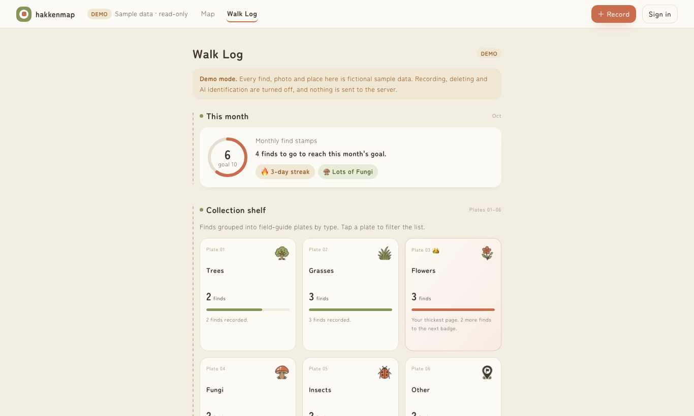
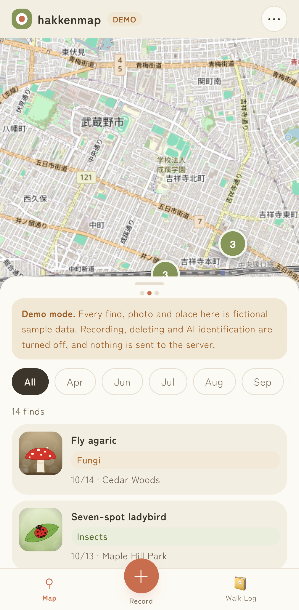
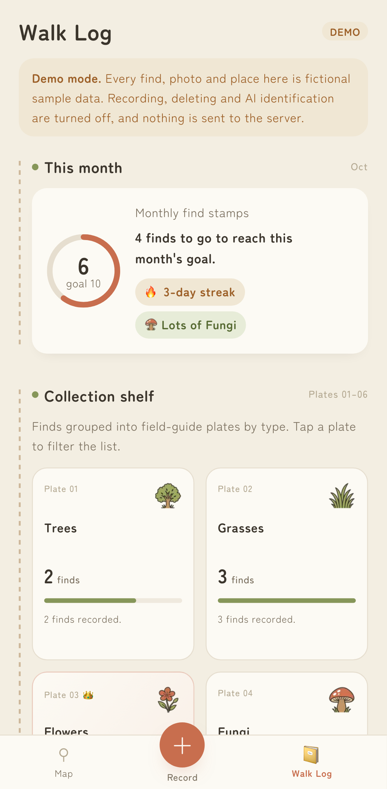
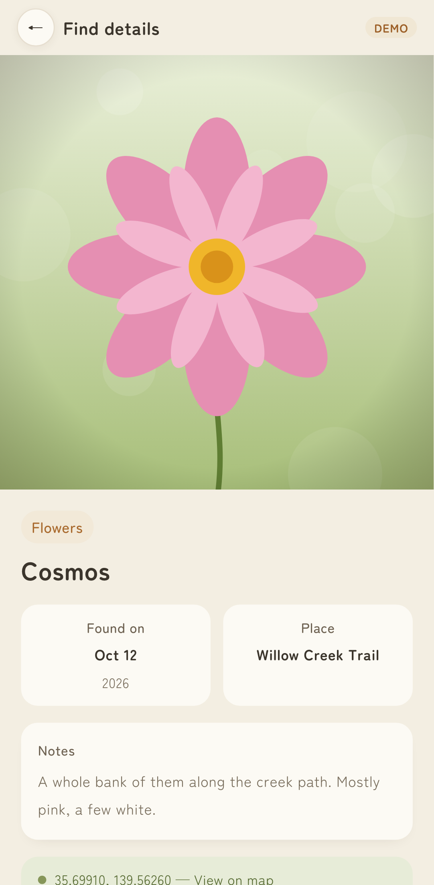

# hakkenmap — a field journal for things you find on walks

hakkenmap ("discovery map") lets you photograph plants, fungi and insects on a walk and keep them
on a personal map. Location and date are read from the photo, an AI model suggests what you found,
and a "walk log" turns your records into a field-guide style collection.

**Live demo (no sign-in):** https://hakkenmap.org/demo &nbsp;·&nbsp; App: https://hakkenmap.org (Google sign-in)

The demo uses fictional sample finds and illustrated photos. It is read-only: recording, deleting and
AI calls are disabled and it makes no requests to the database. The app itself is in Japanese; the
demo is in English.

| Map + list | AI name suggestions | Walk log |
|---|---|---|
|  |  |  |

| Mobile map | Mobile walk log | Mobile detail |
|---|---|---|
|  |  |  |

## Who it is for

People who notice plants and small creatures on everyday walks and want a private, visual record of
what they saw and where — a personal journal rather than a scientific survey tool.

## Features

- **Record a find** from a photo. Date and GPS are read from EXIF in the browser; photos without GPS
  are still saved and appear in the list (just not on the map).
- **AI name suggestions** (Gemini) for a single photo: tap a candidate to use it as the name.
- **Bulk upload** of many photos at once, with per-photo status, a success/failure summary and a
  "retry failed" button that never creates duplicates.
- **Map + list explorer** with marker clustering, month and category filters, and a bottom sheet on
  mobile / side panel on desktop.
- **Walk log**: monthly goal ring, streaks, a collection shelf per category, places visited and a
  yearly journal.
- **Private by default**: each user can only see their own finds and photos (Postgres RLS).

## Tech stack

| Area | Choice |
|---|---|
| Framework | Next.js 16 (App Router, Turbopack), React 19, TypeScript |
| Styling | Tailwind CSS 4 with design tokens in `app/globals.css` |
| Map | Leaflet + react-leaflet + leaflet.markercluster, OpenStreetMap tiles |
| Auth / DB / files | Supabase (Google OAuth, Postgres with RLS, private Storage bucket) |
| AI | Google Gemini via `@google/genai`, called only from a server route |
| Tests | Vitest + Testing Library (unit/integration), Playwright (E2E), SQL test for RLS |
| Hosting | AWS EC2 (Nginx + PM2) behind CloudFront |

```
browser ──▶ CloudFront ──▶ Nginx ──▶ Next.js ──▶ Gemini (/api/identify only)
   │
   └──────▶ Supabase (Auth, Postgres + RLS, Storage)   ← photos and records go here directly
```

Key files: `app/lib/submit.ts` (save + retry logic), `app/lib/identify/` (AI endpoint and client),
`app/lib/storage.ts` (signed photo URLs), `app/lib/app-mode.tsx` (shared screens for the app and the
demo), `supabase/migrations/` (schema and policies).

## Getting started

Requirements: Node.js 22+, a Supabase project, a Gemini API key.

```bash
npm ci
cp .env.local.example .env.local   # fill in the values below
npm run dev                         # http://localhost:43000 (the demo works without Supabase data)
```

### Environment variables

| Name | Where | Purpose |
|---|---|---|
| `NEXT_PUBLIC_SUPABASE_URL` | browser + server | Supabase project URL |
| `NEXT_PUBLIC_SUPABASE_ANON_KEY` | browser + server | Supabase anon key (safe to expose; access is enforced by RLS) |
| `GEMINI_API_KEY` | server only | Used by `/api/identify`. Never exposed to the browser |
| `SUPABASE_SERVICE_ROLE_KEY` | scripts only | `scripts/verify-rls.mjs`, `scripts/cleanup-orphan-photos.mjs`. Not used by the app |

### Database and RLS

1. Apply `supabase/migrations/*.sql` in filename order (SQL editor, or `supabase db push` after
   `supabase link`). This creates the tables, RLS policies, the private `photos` bucket with its
   policies and limits, and the daily AI quota function.
2. Enable Google as an auth provider and add `<your-origin>/auth/callback` to the redirect URLs.
3. Check isolation with `supabase/tests/rls_test.sql` — see [docs/security.md](docs/security.md).

## Tests

```bash
npm run typecheck && npm run lint
npm test                 # 48 unit/integration tests (Vitest, no network)
npm run build && npm run test:e2e   # 14 Playwright tests: demo on desktop + mobile, auth guards
```

What is covered:

- `/api/identify`: 401 when signed out, 400 for non-images (checked by magic bytes), 413 for large
  files, 429 at the daily limit, 503/502 when Gemini fails, and a successful retry afterwards.
- Saving: photo upload failure does not create a record; a failed record save removes its photo;
  a "saved but the response was lost" save counts as success; retries never duplicate.
- Bulk upload in the real screen: partial failure shows counts and the failed photo, and only that
  photo is retried.
- Record → list → detail → delete (photo removed too), category filtering, photos without GPS,
  signed URL renewal for old records.
- Demo pages on desktop and mobile, with a check that they make no Supabase or AI requests.
- RLS: user B cannot read, change, delete or list user A's records and photos (SQL, runs in CI on a
  local Supabase).

External services are replaced by an in-memory fake (`tests/unit/fake-supabase.ts`) and stubbed
Gemini responses, so tests never make paid API calls. CI (`.github/workflows/ci.yml`) runs all of
the above on every pull request.

## Deployment

Production runs on EC2 behind CloudFront. Cache policy, release steps and the post-release checklist
are in [docs/deployment.md](docs/deployment.md) (Japanese).

## Limitations

- The app UI is Japanese only; only the demo is in English.
- AI suggestions are unverified model output, limited to 20 requests per user per day. No accuracy
  figures are claimed.
- One photo per find.
- The production WAF currently blocks request bodies over 8 KB, which affects AI suggestions for
  real photos until the rule is adjusted (see docs/deployment.md).
- Map tiles come from the public OpenStreetMap tile server, which is not meant for heavy traffic.

## Authorship

All commits in this repository are by the repository owner (Makoto Onohara).
